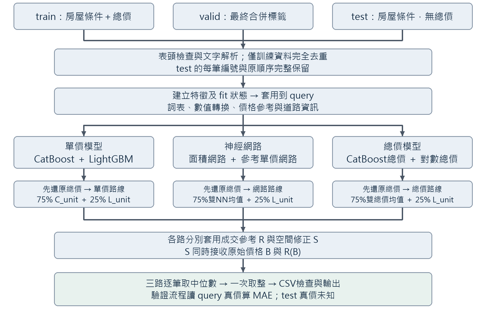
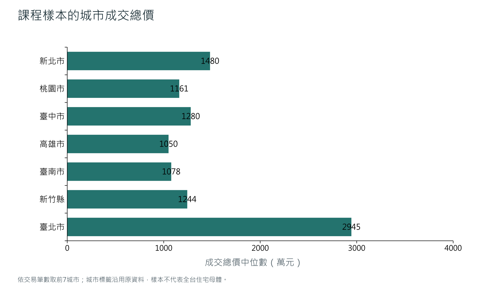
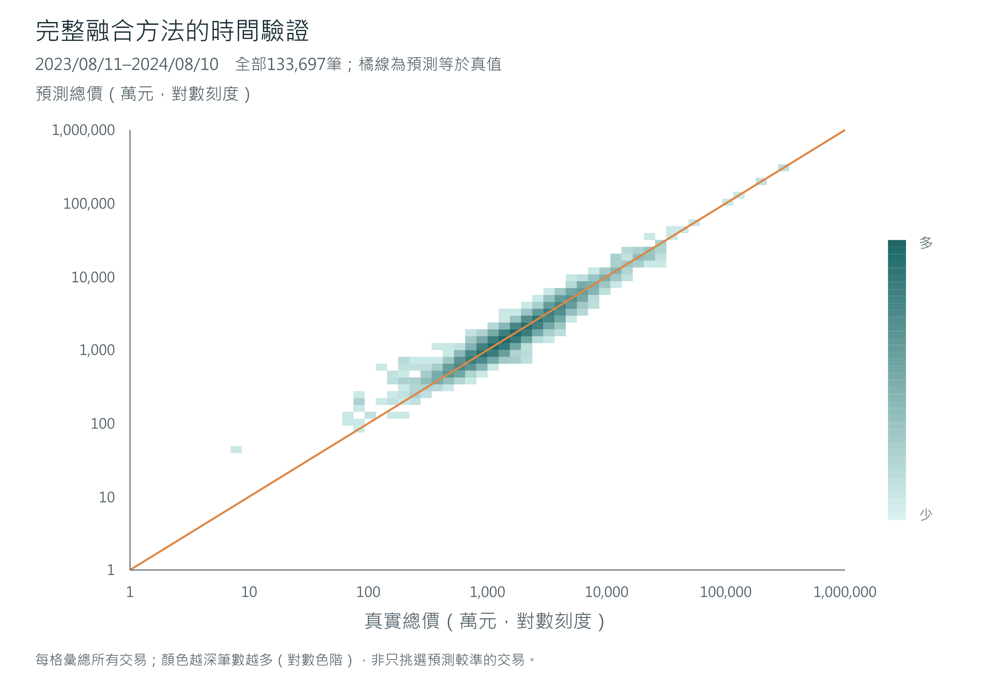
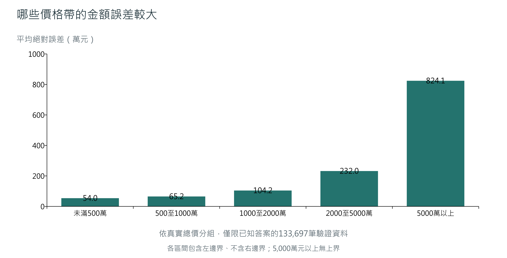
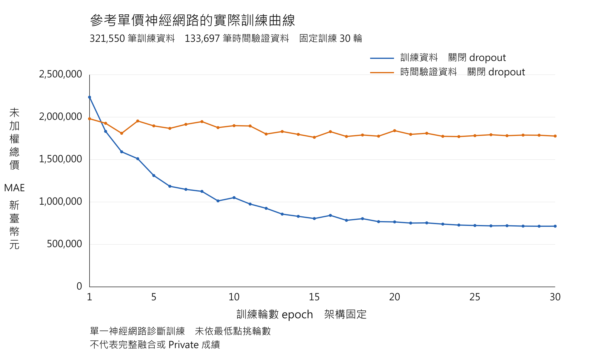

# 台灣房屋銷售價格預測挑戰賽

姓名：廖子頤　　學號：315581048

## 摘要

利用課程提供的房屋交易資料，依地點、面積、樓層、房屋類型與交易時間估計每筆交易的總價。資料先經清理與格式轉換，再交由六個模型學習不同的價格表示。各模型的答案換回總價後，組成三路預測，加入成交參考及空間修正，最後以三路的中位數產生提交答案。

本文依實際估價流程說明每一步的用途與設計理由。資料清理和文字轉換列在正文；模型設定、驗證結果及限制則各自說明，便於對照方法與證據。

## 1 目標與評估指標

這是回歸任務，也就是預測一個數值。最終答案是新臺幣總價；單價只是部分模型內部的學習方式。訓練資料提供成交總價，讓模型學習房屋條件與價格的關係；測試資料沒有提供總價，需由模型估計。

MAE ＝ 每筆交易的絕對誤差加總 ÷ 交易筆數

絕對誤差是不分高估或低估的金額差。例如兩間房屋分別高估100萬元、低估50萬元，MAE就是75萬元。正負誤差不會互相抵銷；MAE也不表示每間房屋都差75萬元。所有正式比較均使用總價MAE，越低越好。

閱讀順序：程式流程 → 資料清理與分布 → 特徵 → 模型與融合 → 訓練 → 時間驗證與誤差分析 → 最終答案。[1]

## 2 完整程式流程

流程由課程交易表開始，經清理、特徵、六個模型、總價還原與三路修正，產生逐筆總價。箭頭表示資料與預測的傳遞；所有依標籤建立的狀態都受當次訓練範圍限制。[1][2][6]



圖1 資料、程式、模型與輸出流程

年度驗證時，只用切點以前的train建立fit狀態，切點以後的query標籤留到預測封存後才評分；課程valid到最終階段才合併。test只套用已建立的狀態，不參與詞表、價格參考或模型學習。

圖呈現完整架構。實際最終全量階段僅新增訓練參考單價神經網路，其餘五模型沿用保存預測；成交參考與空間狀態也沿用既有保存版本，再重算新的網路路線。

## 3 程式分工與核心寫法

資料處理、訓練及最終組合分成不同函式，讓每一步可檢查輸入、列序與檔案身分。下表列出主要程式責任；歷史檔名沿用以便追查。[1][2][6]

| 階段 | 來源與函式 | 主要責任 |
| --- | --- | --- |
| 讀取與去重 | model_common.py<br>load_data / full_training_data | 讀課程資料；檢查表頭；按原欄位去重 |
| 特徵解析 | house_features.py<br>build_features | 日期、樓層、面積、地址與缺失旗標 |
| 訓練編碼 | round47_nn_encode.py<br>fit_encoder / encode | fit建詞表與數值轉換；query僅套用 |
| 網路訓練 | round107_weighted_smooth_train.py<br>weighted_loss / run | 固定30輪；日期加權SmoothL1 |
| 預測組合 | round107_final_candidate.py<br>apply_prior | 重算網路路線R/S；與保存兩路取中位數 |
| 發行檢查 | 獨立CSV讀取與發行收據 | 核對欄位、編號、列序、整數金額及SHA256 |

### 神經網路路線與最終融合的核心運算

以下摘錄核心運算並拆行；成交參考及空間修正在base與median之間完成。native是新的參考單價網路總價；fixed包含保存的面積網路、LightGBM及另外兩路總價。

```python
base = .75 * (.5 * fixed['area'] + .5 * native)
base = base + .25 * fixed['lgb']
# 依固定狀態將 base 經成交參考與空間修正得到 spatial
median = np.median(
    np.column_stack([spatial, fixed['log'], fixed['unit']]),
    axis=1)
```

最終對median只取整一次，才按指定編號輸出。錯列、重複編號或順序改變都可能把正確價格配到錯誤交易，因此檔案檢查與模型估價同樣需要獨立核對。

## 4 資料清理與重複紀錄

價格標籤來自課程的train與valid；test完整保留指定編號與順序。原始檔案另行保存，清理在處理流程中進行。[1]

| 處理步驟 | 筆數 |
| --- | --- |
| 原始train | 455,787 |
| 移除混入的英文表頭 | −3 |
| 移除表頭後 | 455,784 |
| 移除完全重複紀錄 | −529 |
| 清理後train | 455,255 |
| 最終訓練加入課程valid | ＋11,994 |
| 最終合併再移除完全重複 | −28 |
| 最終有標籤訓練資料 | 467,221 |
| test完整保留 | 47,073 |

### 移除混入表頭

關鍵字是「混入表頭」與「標籤格式檢查」。程式先將總價轉成數值，找出無法轉換或非有限數值的列；只有編號恰為serial number、總價文字恰為total price NTD的列，才允許移除。實際有3列符合。遇到其他未知標籤問題就報錯停止，不會看到英文便刪除。

### 完全重複紀錄去重

關鍵字是「完全重複」「排除識別碼」「保留首次出現」。比較編號以外的全部原始欄位，包含成交總價，全部相同才保留第一筆、移除後續紀錄。這樣可避免相同內容被反覆學習、影響過大。

只有建案或面積相同不足以判為重複。日期、總價或任何其他原欄位不同，就不符合完全重複規則。此規則移除train的529列；最終合併valid時另移除28列。這是欄位去重，沒有外部證據確認每組紀錄均為同一真實交易。

## 5 資料分布與城市房價

清理後train共455,255筆，交易日期介於2008-06-26與2024-08-10。以下只描述這份課程樣本，不包含valid或test價格。全體總價平均1,502.54萬元，中位數1,212萬元，中間50%介於870至1,733萬元。[7]



圖2 城市樣本的總價中位數

| 城市 | 交易筆數 | 平均萬元 | 中位萬元 | 中間50%萬元 |
| --- | --- | --- | --- | --- |
| 新北市 | 102,060 | 1,684.54 | 1,480.00 | 1,067.00–2,035.00 |
| 桃園市 | 83,774 | 1,292.73 | 1,161.00 | 868.00–1,525.00 |
| 臺中市 | 83,686 | 1,546.04 | 1,280.00 | 890.00–1,873.00 |
| 高雄市 | 40,980 | 1,191.11 | 1,050.00 | 760.00–1,405.00 |
| 臺南市 | 32,925 | 1,176.65 | 1,078.00 | 835.00–1,399.00 |
| 新竹縣 | 20,356 | 1,537.19 | 1,244.00 | 850.00–1,826.00 |
| 臺北市 | 20,023 | 3,869.66 | 2,945.00 | 2,020.00–4,518.00 |

臺北市樣本的總價中位數為2,945萬元，明顯高於表內其他城市；各城市平均皆高於中位數，顯示少數高總價交易會拉高平均。總價同時受面積、房型、車位與年份影響，這不是城市單價排名或官方房價指數。

圖表按交易筆數選出七個城市；完整統計保留23個城市標籤類別，其中城市缺失5筆。桃園縣等歷史標籤保持原分類，未合併到桃園市；不同城市的日期組成也未重新配平。

## 6 文字與異常值的處理方式

模型需要一致的輸入形式，因此先解析文字，再保留原資料的缺失與異常狀態。以下為規則示例，不是新增交易。[1]

### 空白與數字

去除前後空白及全形空白；空字串、nan、NaN、None、null、<NA>統一視為缺失。數字先去除千分位逗號，再嘗試轉換，例如「1,200.5」變成1200.5。轉換失敗或正負無限大設為缺失；類別空值以專用缺失標記表示。

### 交易日期

解析民國與西元日期。民國年加1911，例如「112年8月11日」轉成2023-08-11，再取年、月、季、日及相對2000年的時間索引；月份另用sin與cos表達週期。無效日期設為缺失。年份超出1990至2030時，設為缺失並標記異常，不硬改成邊界年份。

### 樓層與交易筆棟數

中文數字轉成數值，例如「十二層」為12、「地下二層」為−2。移轉層次拆成最低、最高、平均樓層、層數與跨度，另標記地下、整棟及屋頂。「三至五層」的層數為3；跨地下與地上時不計第0樓。「土地1建物1車位2」則拆成土地1、建物1、車位2。

### 地址與有限備註

地址中的「台」統一成「臺」，拆出縣市、行政區、道路、路段及里村段資訊；棟及號另取棟別與樓層。原地址仍可作類別資訊，道路地理資訊不等於精確門牌定位。備註只用固定詞組建立親友交易、裝潢、毛胚、增建、預售、持分、特殊出售及無建物等旗標，不輸入完整價格文字。

### 異常數值保留標記

保留可解析的面積與格局值，另標記負值、面積為0和極端值。例如土地面積大於10,000或建物面積大於2,000平方公尺；房或衛大於20、廳大於10。極端數值本身不是直接刪除交易的理由，合法高價房也不因價格高就被排除。

## 7 特徵與資料隔離

特徵就是模型估價時可使用的線索。面積相同的房屋，也可能因地點、樓層或交易時間不同而有不同總價，因此需要共同考慮多項條件。[1][2]

| 特徵類別 | 提供的線索 |
| --- | --- |
| 地點 | 縣市、行政區、地址、道路與建案資訊 |
| 房屋條件 | 土地與建物面積、車位、樓層、格局、型態與用途 |
| 交易時間 | 年、月、季、日期索引與月份週期 |
| 資料狀態 | 缺失、日期異常、面積與格局異常旗標 |
| 道路地理 | 道路位置、範圍及匹配狀態等非價格資訊 |

### 不放進模型的欄位

編號只用來對齊提交，總價是要學習的答案，兩者都不作輸入。建築完成年月不可用，因此沒有據此建立可靠屋齡；管理組織為常數，無法區分房屋。解約情形可能是交易後資訊，也不納入。

### 模型輸入如何建立

基礎特徵共87欄，加上8欄道路地理資訊為95欄，其中23欄為類別。參考單價神經網路將72個數值欄位依訓練中位數填補，再用訓練尺度與asinh轉換處理，並附72個非有限值旗標，共144個數值輸入。asinh在數值很大時壓縮尺度，也能處理負值。

類別先建立訓練詞表，再轉成模型可學習的向量，也就是embedding。訓練中少於5次或預測時未見過的類別使用0編碼。另一個面積神經網路再加入依訓練分位節點建立的分段數值表示，數值輸入為603維。

### 規則只由訓練資料建立

每次驗證的訓練部分稱為fit，待評分部分稱為query。中位數、尺度、類別詞表、分位節點及價格參考都只在fit建立，再套到query。這可避免待評分資料提前影響模型規則。固定的日期與樓層解析規則則一致套用各資料集。

## 8 六個模型的估價方式

六個模型使用不同價格表示，讓各自擅長的關係有機會互補。CatBoost與LightGBM都以多棵樹逐步修正誤差；神經網路則以多層數值運算學習特徵組合。模型多並不保證更準，效果仍需驗證。[2]

| 符號 | 模型與學習目標 | 還原總價方式 |
| --- | --- | --- |
| C_unit | CatBoost單價 | 單價乘有效面積 |
| L_unit | LightGBM單價 | 單價乘有效面積 |
| C_raw | CatBoost總價 | 直接輸出總價 |
| C_log | CatBoost對數總價 | 反轉log1p價格轉換 |
| N_area | 面積神經網路 | 正值單價乘有效面積與單位換算 |
| N_prior | 參考單價神經網路 | 參考單價乘有效面積，再乘預測倍率 |

### 單價與總價為何分開學

單價模型可比較不同面積的房屋，但最後必須乘回面積，才能用總價MAE評估。例如單價每平方公尺20萬元、面積40平方公尺，總價為800萬元。C_unit訓練採面積與日期權重，讓單價誤差較能對齊近期總價誤差。

直接總價模型保留金額尺度；對數總價模型學log1p（總價÷1,000,000），讓大金額在學習表示中受到壓縮，再轉回總價。對數模型的訓練損失位於對數空間，不能稱為直接總價MAE。

### 有效面積的回退

有效面積優先採正且有限的建物面積，否則採有效車位面積，再無法使用才取1，讓乘除計算能繼續。這個1不是估計室內面積，也不會改寫原面積特徵。面積神經網路的單價輸出以萬元／平方公尺表示，還原時還需乘10,000。

## 9 參考單價與建案分組

參考單價先提供區域與房屋類型的大致價格起點，再由神經網路學習個別交易的調整倍率。價格參考只使用當次fit提供的標籤。[2]

預測總價 ＝ 參考單價 × 有效面積 × 預測倍率

假設參考單價為每平方公尺20萬元、有效面積40平方公尺，價格起點為800萬元；模型若預測倍率1.2，便得到960萬元。這只是公式示例，倍率由模型學習，不由未知真價倒算。

| 查詢次序 | 參考分組 | 最低原始筆數 |
| --- | --- | --- |
| 1 | 城市＋行政區＋交易類型＋建物類型 | 30 |
| 2 | 城市＋交易類型＋建物類型 | 30 |
| 3 | 交易類型＋建物類型 | 30 |
| 4 | 交易類型 | 30 |
| 5 | 全域可用參考 | 無30筆門檻 |

細分組資料不足就退回較粗分組，避免少量交易決定參考價格。每層採365天半衰期的日期加權中位單價：將單價由低至高排序，取累積權重首次達到總權重一半的位置；恰好到一半時，取相鄰單價平均。近期交易的權重較大，較容易影響中位位置，沒有把價格乘上權重。缺日期採中性權重1，前四層筆數門檻仍按原始支持量計算。

### 避免自己的答案回到自己的參考

依城市、行政區與建案組成分組鍵，再分成五折；缺建案時以地址、道路或單筆鍵回退。一折房屋的參考單價只由另外四折建立，稱為分組五折OOF。待預測房屋則使用完整fit的參考；建案用於分組，不是上表查詢條件。

這種分組不等同逐筆時間隔離：同一fit內，參考交易可能比某筆訓練交易晚。歷史驗證另外用外層時間切點，限制整套fit不得包含驗證期間的交易；兩種隔離處理的是不同問題。

## 10 三路融合與成交參考修正

所有輸出先統一成新臺幣總價，再依固定比例形成三路答案。75%與25%是既定配方，並非每份資料上的最佳比例。[2]

| 路線 | 原始組合 |
| --- | --- |
| 單價路線 | 75% × C_unit ＋ 25% × L_unit |
| 神經網路路線 | 75% ×（N_area與N_prior各半）＋ 25% × L_unit |
| 總價路線 | 75% ×（C_raw與C_log各半）＋ 25% × L_unit |

### 可比成交與空間修正

每一路先利用fit中同建案、地址、道路等可比交易，以及fit估計的時間趨勢，修正原始估價，記為R。接著再利用固定空間參考狀態，補充直接參考較弱的情況，記為S；支持不足時回退。

一路修正結果 ＝ S（原始組合B，R（B））

S同時接收原始估價與成交參考修正後的估價，所以不能把流程說成兩次相同校正直接相加。新的時間切點需要建立自己的成交參考與空間狀態。

### 逐筆取三路中位數

將三路修正後的價格由低至高排序，取中間那個。假設某間房屋得到1,000、1,100、1,600萬元，最終為1,100萬元。中位數可降低單一路線極端值的影響，並沒有找出真正成交價。

三路共同使用LightGBM與相關資料，並非完全獨立。如果三路一起高估，中位數仍會高估；它也可能擋掉某一路正確的改善。因此融合仍需要相同交易上的公平驗證。

## 11 訓練損失與固定設定

參考單價神經網路採日期加權SmoothL1。比較基準採日期加權總價MAE，其餘輸入、架構、先驗及融合設定固定。SmoothL1的設計是讓接近正確價格時的更新較平滑，較大誤差仍保留線性尾部。[2]

誤差e以百萬元表示，轉折值β＝0.1，即10萬元。誤差絕對值小於β時，單筆損失為e²÷（2β）；大於或等於β時，為|e|−β÷2。它改變學習時的懲罰方式，沒有刪除高價房，也沒有改變正式MAE評分。

批次訓練損失 ＝ 各筆「日期權重 × SmoothL1損失」的平均

日期權重讓較近期交易對訓練影響較大。相差一年的有效日期，原始權重比例為1比2，再除以fit中有效日期的原始權重平均值；缺失或異常日期維持1。每個批次不再除以批次權重和。參考單價也使用日期權重，但用途是選擇參考中位位置。

| 設定 | 固定內容 |
| --- | --- |
| 隱藏層 | 512、256、128；LayerNorm與ReLU |
| 正規化 | Dropout 0.1；category dropout 0.1 |
| 輸出 | Softplus正值倍率 |
| 訓練輪數與批次 | 30輪；每批2,048筆；seed 42 |
| 最佳化 | AdamW；學習率0.001；weight decay 0.0001 |
| 學習率排程 | CosineAnnealingLR；T_max 30；最低0.00001 |
| 模型選擇 | 固定最後第30輪，未依驗證最低點挑選 |

學習率控制參數每次更新的幅度；dropout在訓練時隨機停用部分單元，降低對特定路徑的依賴。推論時關閉dropout，沿用訓練好的參數與轉換規則。面積神經網路仍使用總價絕對誤差，沒有額外日期樣本權重，不能將六模型都稱為同一損失。

## 12 時間驗證與離線結果

估價要面對未來交易，因此年度回測只用train中早於驗證首日的交易建立模型，再評估接下來一年；課程valid留到最終訓練才合併。每個切點都建立自己的模型、轉換規則、參考單價、成交參考及空間狀態，避免帶入後期資訊。[3]

| 驗證期間 | fit筆數 | 驗證筆數 |
| --- | --- | --- |
| 2021/08/11 至 2022/08/10 | 134,805 | 105,511 |
| 2022/08/11 至 2023/08/10 | 240,316 | 81,234 |
| 2023/08/11 至 2024/08/10 | 321,550 | 133,697 |
| 2023/02/11 至 2024/02/10 | 272,117 | 107,169 |

基準與此方法在相同房屋上比較，以下單位皆為新臺幣元。差值是此方法減基準，負值代表誤差降低；最終全量模型不直接用來回測自己已學過的歷史。

| 驗證期間 | 基準MAE | 此方法MAE | 差值 |
| --- | --- | --- | --- |
| 2021/08 至 2022/08 | 2,309,352.36 | 2,310,236.02 | ＋883.66 |
| 2022/08 至 2023/08 | 1,407,387.07 | 1,405,971.19 | −1,415.88 |
| 2023/08 至 2024/08 | 1,383,228.41 | 1,381,702.87 | −1,525.54 |
| 額外2月起點 | 1,336,410.67 | 1,336,107.62 | −303.06 |

### 整體改善仍可能有群體退步

三個主要期間有兩期改善、一期退步，最近一期改善約0.1103%。最近年度既有建案MAE增加213.10元，新建案減少2,841.61元。依test已知的既有建案36.62%與新建案63.38%加權，差值為−1,723.04元；這是組成診斷，不是test真價誤差，也不是官方評分。

各窗口已反覆參與方法比較，且部分時間重疊，不能視為四次獨立盲測。相同交易上的比較提高公平性，仍無法消除反覆選型對結果的影響。

## 13 完整融合的驗證結果圖

本節分析2023-08-11至2024-08-10的133,697筆時間驗證交易。模型及所有狀態來自較早的321,550筆fit；使用保存的完整三路融合未取整總價，並非下節單一神經網路的逐輪預測。[8]



圖3 完整融合的真價與預測總價

| 完整驗證指標 | 金額或比例 |
| --- | --- |
| 總價MAE | 1,381,702.87元 |
| 絕對誤差中位數 | 769,778.47元 |
| 第90百分位絕對誤差 | 3,172,581.28元 |
| 第99百分位絕對誤差 | 8,929,452.75元 |
| 平均有號誤差（預測減真價） | -354,468.49元 |
| 低估交易比例 | 52.20% |

橘色對角線表示預測等於真價，圖點越接近此線，價格越接近。全133,697筆交易依真價與預測的對數萬元座標，彙整到64×64格，色彩深淺表示密度，並未抽取少量交易。每相同刻度的金額倍數相同；極端交易仍需搭配金額誤差及案例解讀。

MAE約138.17萬元，大於絕對誤差中位數約76.98萬元，說明較大的誤差拉高平均；平均有號誤差為負，表示全體淨低估約35.45萬元。低估比例約52.20%，不能把淨低估解讀為每筆都低估。

## 14 價格帶與尾端誤差

為定位整體平均遮住的問題，再依驗證真價分組檢查。價格帶只用於預測完成後的分析，不能用未知test真價決定模型分支或人工調價。[8]



圖4 完整融合在各真價價格帶的誤差

| 分析項目 | 筆數 | MAE或絕對誤差占比 |
| --- | --- | --- |
| 既有建案 | 57,601 | MAE 82.07萬元 |
| 新建案 | 76,096 | MAE 180.63萬元 |
| 誤差最大的1% | 1,337 | 占絕對誤差總額10.65% |
| 誤差最大的5% | 6,685 | 占絕對誤差總額28.01% |
| 誤差最大的10% | 13,370 | 占絕對誤差總額41.64% |

首價格帶為未滿500萬元，其餘採左含右不含：例如500至1,000萬元代表500萬元≤真價<1,000萬元。真價5,000萬元以上的2,044筆，MAE約824.08萬元；500至1,000萬元的24,411筆約65.17萬元。各帶沒有控制面積或房型，不能單憑此圖斷言價格本身造成誤差。

新建案指當期fit未出現相同「城市、行政區、建案名稱」組合，並不等於屋齡較新。新建案MAE約180.63萬元，比既有建案高，與缺少直接同案參考的可能困難一致；仍可能同時受到城市、用途及面積組成影響。

尾端少量交易貢獻較多絕對誤差，但合法高價交易仍是任務的一部分。後續改進必須同時檢查整體與分群，不能只刪除困難交易來降低表面MAE。

## 15 實際訓練與驗證曲線

為觀察學習過程，另以固定參考單價神經網路配方進行30輪診斷訓練。這張圖呈現一個神經網路的學習狀況；六模型融合結果需看完整融合的整體驗證。[4]



圖5 單一參考單價神經網路的診斷曲線

| 評估資料 | 第1輪MAE | 固定第30輪MAE |
| --- | --- | --- |
| 訓練資料 | 2,235,313.48 | 715,006.13 |
| 時間驗證資料 | 1,981,140.43 | 1,777,133.98 |

藍線是321,550筆訓練交易，橘線是之後133,697筆時間驗證交易。兩線都在關閉dropout後，計算未加權總價MAE，單位為元；並非SmoothL1訓練損失。橘線後段改善有限且波動，訓練誤差整體下降不等於對未來的估價持續改善。

30輪快照先封存，再讀驗證答案評分，沒有依橘線最低點挑輪數，也沒有改提交答案。此圖不是原提交當時的訓練紀錄；時間組成及訓練OOF／驗證完整fit參考差異也會影響兩線距離。落差不能全歸因於過擬合，也不能據此證明完全沒有過擬合。epoch是學習輪數，不能稱為模型容量或VC維度。

## 16 大誤差交易案例

從最近年度133,697筆保存驗證預測，依絕對總價誤差由大到小排序，取第1、3、4名作不同情境的案例A、B、C。略過與A條件相近的第2名；這是刻意選出的困難案例，不代表一般交易。[8]

| 案例 | 地點與類型 | 真價萬元 | 預測萬元 | 誤差萬元 |
| --- | --- | --- | --- | --- |
| A | 新北市新莊區<br>廠辦 | 299,000.00 | 280,336.82 | 低估<br>18,663.18 |
| B | 臺北市北投區<br>辦公商業大樓 | 14,858.00 | 24,332.19 | 高估<br>9,474.19 |
| C | 新北市林口區<br>店面(店鋪) | 25,600.00 | 16,270.29 | 低估<br>9,329.71 |

| 案例 | 交易日期 | 建物面積m² | 車位數 | 同建案fit筆數 |
| --- | --- | --- | --- | --- |
| A | 2024-05-28 | 19,410.47 | 130 | 0 |
| B | 2024-07-05 | 794.71 | 5 | 0 |
| C | 2024-04-28 | 831.31 | 3 | 130 |

三筆皆為房地加車位交易；「同建案fit筆數」只統計該切點以前相同城市、行政區與建案名稱的交易。A和B當時沒有直接同案樣本；C已有130筆，仍發生明顯低估。

### 案例A 大面積廠辦低估

新莊廠辦建物面積19,410.47平方公尺，含130個車位，真價29.90億元，預測約28.03億元，低估約1.87億元，約為真價的6.24%。同案支持為0，且面積遠高於fit第99百分位345.10平方公尺，符合大規模稀有交易可能較難估價的假設，仍未證明誤差原因。

### 案例B 新建案商辦高估

北投商辦面積794.71平方公尺、5個車位，真價約1.49億元，預測約2.43億元，高估約9,474.19萬元。當期無同案樣本，面積亦高於fit第99百分位。區域或用途參考未必足以描述該筆交易，不能將高估直接歸因於單一模型。

### 案例C 同案資料存在仍低估

林口店面面積831.31平方公尺、3個車位，真價2.56億元，預測約1.63億元，低估約9,329.71萬元。同案130筆全為住宅大樓，無同型店面；同案真價中位數約2,121.50萬元。用途與規模缺乏可比支持，顯示「有同案」不等於「有足夠可比交易」。

## 17 誤差原因與對應改進

案例中的日期、用途、面積、車位、真價、預測及同案支持量都是已觀察證據。以下原因屬待驗證假設；目前沒有藉由重訓對照證明因果，也沒有依案例改動提交價格。[8]

### 依用途與規模檢查可比性

A、B、C的建物面積都高於fit第99百分位。廠辦、商辦與店面也可能具有不同估價關係。可先以fit可知的用途與面積預先定義群組，比較群組模型或更細緻的可比交易規則；驗證必須保留原高價交易，並檢查是否犧牲一般住宅的MAE。

### 把參考支持量納入信任程度

現有參考已按建物類型與主要用途分組；此處同案130/0是描述性盤點，不等於實際reference支持量。下一步可檢查各層實際支持，測試既有分組內相近面積／車位條件與支持不足回退。門檻訓練前固定。

### 避免三路共同偏向同一方向

三路共享LightGBM與部分資料、參考狀態；中位數只抑制單一路線的極端值。若三路對同一稀有用途都偏低或偏高，最終仍會出錯。可保存逐路誤差及相關性，預先設計固定消融，確認是原模型、參考修正或融合哪一段需要改進。

### 用新的時間留出檢驗改進

既有年度窗口已反覆用於選型，現在案例也是同一批窗口的事後分析。任何新特徵、分群或融合規則，都應先固定假設與設定，再用尚未參與選型的新時間留出及多seed對照。先比較整體MAE，再檢查城市、建案狀態、用途與尾端退步；沒有新標籤時，保留改善尚待確認的結論。

案例總價高於fit第99百分位5,597萬元，是取得驗證真價後才可描述的結果；部署時只能用已知房屋條件辨識可能超出訓練範圍，不能用test未知真價選規則。

## 18 公開成績與結論的限制

Public約使用test的30%計分，Private約為其餘70%；這與課程valid不同。公開成績只能描述公開部分，不能直接推論隱藏部分。[3][5]

| 方法 | 使用者回報Public MAE元 |
| --- | --- |
| 基準方法 | 1,998,568.5706 |
| 最終提交方法 | 1,995,836.2136 |
| 差值 此方法減基準 | −2,732.3570 |

公開MAE約199.58萬元，比基準降低約2,732元，約0.1367%。此數值原由使用者回報，已由本次截圖及登入Kaggle頁面核對；尚未核對平台上傳檔案bytes，Private未知。

### 離線較好仍可能在平台較差

另一對照方法在原三期整體及固定加權離線指標都優於基準，Public卻為2,083,045.2932元，反而較差；它在最早及最近年度的離線MAE也優於最終方法。這表示歷史驗證無法保證平台表現，不能只保留支持最終方法的比較。

### 改善幅度與證據界線

原強條件要求三窗整體與固定加權都改善、最近至少改善0.5%，並檢查季度和大型群退步。此方法未通過原強條件；它通過的是訓練前另訂的探索提交條件，不能把兩者混為一談。

依保存預測進行建案配對重抽樣，最近年度整體差值95%區間約為−3,594.91至＋523.35元，跨過0，尚不能據此宣稱穩定勝出。重抽樣沒有重新訓練，也未校正反覆選型及未來分布變動，改善比例不是Private勝率。

每次參考單價神經網路使用單一seed；基準使用保存結果，沒有同期重新訓練完全匹配的對照。因此小幅差異不能完全分離為損失函數的單獨效果，也未涵蓋GPU重訓變異。

## 19 最終答案與可追溯性

原全量階段使用467,221筆有標籤資料，只新訓練參考單價網路，其餘五模型沿用保存預測。[6] 後續已在同機既有與全新獨立套件環境，從保存模型及轉換狀態重新執行六模型推論；47,073筆的13個完整向量及答案檔皆核對一致，沒有重新訓練。[9]

### 提交檔案檢查

最終總價只取整一次，依指定編號順序輸出「編號」與「總價元」兩欄，共47,073筆。以獨立CSV讀取檢查欄名、列數、編號、順序、整數金額及全檔指紋，確保交付對應同一份答案。編號只用於對齊，不用來人工調價。

整數總價 ＝ max（rint（最終總價），1）

最終提交檔SHA256如下，兩行串接為完整指紋：

36231cd17a6cbeafefeb62a7989d207fa20

d6c5f7aaf99857e4d9addd25597c1

### 保存與重現

來源、設定、模型重載、預測組合與答案檔身分都有保存證據。相對基準有13,002筆取整價格不同；未取整預測的平均絕對差為29,521.0062元，這是兩份預測的差，不是真價誤差或改善金額。

程式包另補22支原訓練／準備程式及2份設定／欄位規格，不含交易表、私有模型或CSV。歷史路徑、私有準備陣列、價格狀態與保存預測依賴保留。從原始train／valid重訓全部六模型尚未驗證；同機推論成功不保證任意硬體重訓相同。[9]

### 結論與證據來源

整套流程結合資料清理、價格表示、參考資訊與固定融合，並以時間驗證檢查未知交易的估價能力。目前可觀察到小幅改善，但跨期與分群結果不一致，Private未知。後續應優先使用新的時間留出資料及多seed對照確認穩定性。

[1] 資料讀取、完全去重與特徵解析程式。

[2] 六模型訓練、神經網路編碼、參考單價及融合來源。

[3] 三年度與額外二月起點的離線結果、分群及重抽樣紀錄。

[4] 固定30輪診斷的逐輪MAE、快照及保存預測核對。

[5] 最終選定、使用者公開分數回報與本次平台頁面核對。

[6] 全量訓練設定、模型重載與CSV發行核對。

[7] 清理後train的城市總價描述統計與樣本分布。

[8] 封存完整融合驗證預測的列序、誤差、分群及匿名案例核對。

[9] 六模型完整推論、兩套環境核對及原訓練來源補件。

程式與證據入口：github.com/ziyi930108/nycu-house-price-regression（需權限）。

詳細證據與數據來源見 [來源對照](docs/REPORT_SOURCES.md)。
