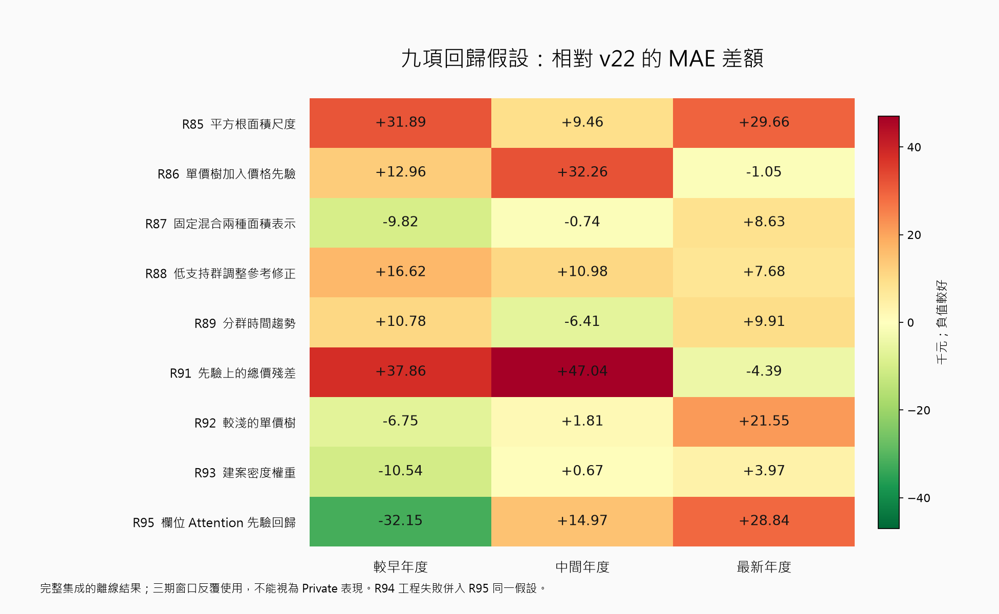

# 九項回歸改良研究：R95 完成後彙整

本頁由已完成的結果與決策 JSON 產生，沒有重訓、推論或重新讀取價格標籤。選定版本仍為 v22；Private 未知。各輪的採用理由和有利反證仍以原報告為準。

差額＝新候選 MAE − v22 MAE，單位為新臺幣元；負值代表該期改善。

|假設|較早年度|中間年度|最新年度|新 fit：樹／NN／wrapper|
|---|---:|---:|---:|---:|
|[R85 平方根面積尺度](round85_report.md)|+31,888.74|+9,458.39|+29,656.69|3/0/0|
|[R86 單價樹加入價格先驗](round86_report.md)|+12,956.06|+32,262.95|-1,051.01|3/0/0|
|[R87 固定混合兩種面積表示](round87_report.md)|-9,817.53|-735.06|+8,628.64|0/0/0|
|[R88 低支持群調整參考修正](round88_report.md)|+16,617.14|+10,977.52|+7,675.02|0/0/0|
|[R89 分群時間趨勢](round89_report.md)|+10,775.59|-6,406.67|+9,907.03|0/0/3|
|[R91 先驗上的總價殘差](round91_report.md)|+37,857.15|+47,037.46|-4,394.69|3/0/0|
|[R92 較淺的單價樹](round92_report.md)|-6,753.95|+1,812.80|+21,554.79|3/0/0|
|[R93 建案密度權重](round93_report.md)|-10,540.53|+666.90|+3,968.28|3/0/0|
|[R95 欄位 Attention 先驗回歸](round95_report.md)|-32,152.87|+14,973.87|+28,835.21|0/3/0|

共 15 次樹模型、3 次 NN、3 次 CPU 趨勢 wrapper fit。真 fit 合計 3932.126 秒，已包含於各成功 main 合計 4798.733 秒；兩者不可相加。

R94 在真 fit 前因舊 JSON 讀取契約失敗，耗時 7.813 秒；原檔保留，R95 是相同科學配置的工程恢復，不能重算一項新假設。合成、開發、審查、診斷、發布時間不在上述 main 合計，整段聊天時間沒有實測。

多轮重用年度窗口帶來選型偏差；各假設亦非獨立重複試驗，不能從這張表推論 Private 勝率。不能只挑某一期改善、某個原生分支勝出或訓練 loss 下降就宣布新提交更好。

[機器可讀彙整與來源 SHA](../outputs/regression_after_r95_20260929/summary.json)；[R95 完整分析](round95_report.md)。
