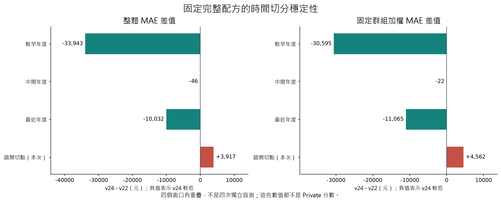

# R97：換一個時間切點，完整回歸配方是否仍穩定？

本輪重新訓練完整 v22／v24 所需的七個模型及全部學得狀態，保留原配方。這是時間穩定性證據；沒有提出或採用新的提交版本。

## 四個窗口一起看

| 評分窗口 | fit／query 列數 | v22整體MAE | v24整體MAE | v24−v22 | 加權差值 |
|---|---:|---:|---:|---:|---:|
| 2021-08-11～2022-08-10 | 134,805／105,511 | 2,309,352.36 | 2,275,409.14 | -33,943.22 | -30,594.69 |
| 2022-08-11～2023-08-10 | 240,316／81,234 | 1,407,387.07 | 1,407,340.72 | -46.35 | -21.82 |
| 2023-08-11～2024-08-10 | 321,550／133,697 | 1,383,228.41 | 1,373,195.92 | -10,032.49 | -11,064.53 |
| 2023-02-11～2024-02-10 | 272,117／107,169 | 1,336,410.67 | 1,340,328.14 | +3,917.46 | +4,561.93 |

原三個8月起點來自既有保存結果；只有2023-02-11起點是本輪完整重訓。窗口與訓練資料重疊，不能相加當成四組獨立證據。

## 本次配對區間與分群代價

| 抽法 | 指標 | 差值 | 2.5% | 97.5% |
|---|---|---:|---:|---:|
| month | overall | +3,917.46 | +488.17 | +7,176.21 |
| month | weighted | +4,561.93 | +903.73 | +9,072.55 |
| project | overall | +3,917.46 | -6,109.91 | +15,316.77 |
| project | weighted | +4,561.93 | -6,746.06 | +16,849.02 |

本窗口整體與固定加權點估計是否同時改善：否。
本次 v24 的整體 MAE 高約0.293%，四季點估計都較高；月份區塊兩區間皆偏退，建案兩區間仍跨零。不能據此宣稱 v22 在所有情境或Private都較好。
相反證據也保留：原三個8月窗口的v24整體與加權都较低；新窗口seen建案改善543.59元、2千萬至1億元兩價帶改善。新案退7,511.52元、低於2千萬及億元群退；億元群只有270列，不能因未達500列通報規則而略去。
所有城市／月份／新舊建案／五價帶及各層指標均保存，不能只挑平均值。

超過5%退步的季度或至少500列分群：
- 本窗口沒有達到此固定通報條件的分群；不等於每一群都改善。

## 本次實際執行與限制

5個樹模型、2個NN；各模型 fit 計時段合計1,100.391秒，包含在main 1,410.656秒內，不重複相加。另建立新encoder／ramps、group OOF/full prior、reference/spatial。所有query保存模型／state重載一致。
模型driver只接隔離輸出的fit標籤，全部預測封存後才由獨立scorer載query價格。底層價格pickle在隔離extractor與scorer各會反序列化原表，此限制已明記。
固定配方先前已使用重疊資料選型；本輪沒有新的盲測，bootstrap不校正累積選型、重新訓練或未來分布改變，更不是Private勝率。
v22仍是使用者唯一選定提交。Public 1,998,568.5706，Private未知；沒有上傳Kaggle、產生新CSV或更改勾選。
保存模型重載／本機七模型新窗口重訓，不等於全新環境重現最終test模型。

[固定計畫](round97_plan.md) · [主程式](../src/round97_offset_experiment.py) · [評分程式](../src/round97_offset_evaluate.py) · [完整分群報告](../outputs/round97/evaluation/report.md) · [模型封存收據](../outputs/round97/sealed_manifest.json)
