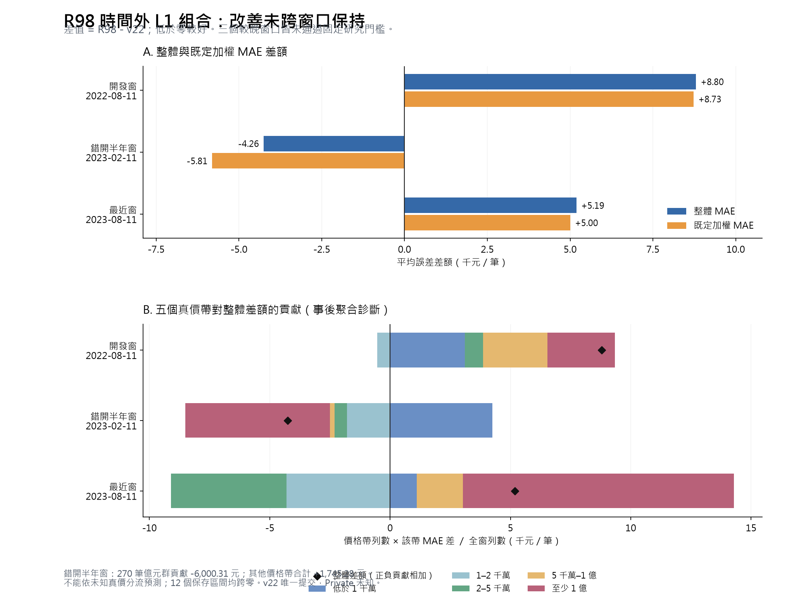

# R98：時間外 L1 三分支組合完成摘要

2026-09-29。**固定研究門檻未通過；保留 v22 唯一提交，不產生新 CSV，Private 未知。**
本頁只讀保存的聚合 JSON 與 meta-fit 收據；沒有讀真價／逐筆預測陣列、載入原生模型，沒有新 fit、predict、score 或 bootstrap。

## 改了什麼、權重如何得到

六個原生模型、特徵、各分支 reference/spatial 都不變。N、H、U 是完成修正後的 NN、log 與 unit 分支；只將逐筆 median(N,H,U) 改成全域非負、和為 1 的線性組合，無截距、分群、衰減或比例搜尋。
每窗獨立用當時較早 forward 預測與標籤最小化等列權 TWD L1：development 用 auxiliary；offset 用 auxiliary＋development 的 2023-02-11 前綴；confirmation 用 auxiliary＋development。每窗独立程序、係數／完整預測封存後才交 scorer。較早 query 合法成為較晚 meta-fit 的角色重疊明載，不能稱整批未見標籤的盲測。

|窗口／起日|meta 列數|query 列數|N 權重|H 權重|U 權重|
|---|---:|---:|---:|---:|---:|
|development / 2022-08-11|105,511|81,234|0.228046466|0.269965391|0.501988143|
|offset / 2023-02-11|137,312|107,169|0.259076768|0.270462352|0.470460881|
|confirmation / 2023-08-11|186,745|133,697|0.331823934|0.271627421|0.396548645|

meta-fit 的最優是固定全域凸組合類別內的解；**逐筆 median 並不包含在這個類別中**。所以即使求解最佳、或優於每一個單支，也不保證優於 v22 median，更不保證未來改善。N 權重隨較晚 meta-fit 增加、U 減少只是保存結果，不能據此斷言市場機制。

## 完整模型結果

差值為 R98 − v22，负值较好，单位新臺幣元。

|窗口|v22 整體|R98 整體|整體差|v22 加權|R98 加權|加權差|
|---|---:|---:|---:|---:|---:|---:|
|development|1,407,387.07|1,416,185.71|8,798.64|1,399,717.74|1,408,446.07|8,728.33|
|offset|1,336,410.67|1,332,155.65|-4,255.03|1,392,890.34|1,387,082.49|-5,807.86|
|confirmation|1,383,228.41|1,388,419.07|5,190.67|1,447,153.42|1,452,155.75|5,002.34|

development／confirmation 整體與加權都較高；offset 的兩者較低，但嘉義縣 1,532 列增加 10.77%，仍未通過事前固定分群條件。並非所有窗口或分群都退步。
門檻是三個較晚窗口的兩個點指標全改善，且任何季度或至少 500 列分群不得超過 5% 退步。這只是升級研究條件，並不是原三期完整採用條件。

|窗口|N 單支整體 MAE|H 單支整體 MAE|U 單支整體 MAE|
|---|---:|---:|---:|
|development|1,469,402.11|1,485,512.75|1,509,405.16|
|offset|1,455,654.40|1,372,629.24|1,394,719.31|
|confirmation|1,403,580.19|1,486,906.73|1,462,277.22|

R98 三窗皆比每支单獨分支低，但與逐筆 median 的比較有得有失；分支與完整模型不能混稱。

## 新舊案、季度與 >5% 反證

|窗口|群|列數|MAE 差|
|---|---|---:|---:|
|development|strata/new_nonmissing|52,253|11,462.58|
|development|strata/seen|28,981|3,995.54|
|development|forecast_quarters/Q1|17,608|-3,366.58|
|development|forecast_quarters/Q2|14,193|28,676.14|
|development|forecast_quarters/Q3|22,487|12,275.90|
|development|forecast_quarters/Q4|26,946|3,376.35|
|offset|strata/new_nonmissing|59,352|-12,914.83|
|offset|strata/seen|47,817|6,493.80|
|offset|forecast_quarters/Q1|22,487|3,646.14|
|offset|forecast_quarters/Q2|27,820|-5,490.14|
|offset|forecast_quarters/Q3|27,006|-14,752.01|
|offset|forecast_quarters/Q4|29,856|439.80|
|confirmation|strata/new_nonmissing|76,096|3,935.73|
|confirmation|strata/seen|57,601|6,848.56|
|confirmation|forecast_quarters/Q1|26,579|18,537.78|
|confirmation|forecast_quarters/Q2|31,157|124.08|
|confirmation|forecast_quarters/Q3|37,236|-12,248.03|
|confirmation|forecast_quarters/Q4|38,725|16,874.45|

|窗口|超標項目|列數|MAE 差|相對增加|
|---|---|---:|---:|---:|
|development|months/2022-12|6,122|77,855.52|6.330%|
|development|cities/基隆市|737|207,295.98|13.148%|
|development|relative_forecast_months/4|5,881|91,294.29|7.478%|
|offset|cities/嘉義縣|1,532|75,675.70|10.769%|
|confirmation|cities/屏東縣|1,013|38,233.45|5.052%|

各超標項目可能重疊，不能相加當不重複退步列數。小於 500 列群仍完整保留，但不改寫原先門檻。

## 五個價格帶對整體差值的分解

每帶貢獻 = 該帶列數 × 該帶 MAE 差 ÷ 全窗列數。五帶合計等於保存的 overall 差（算術誤差核至 0.000001 元）。**這是事後聚合診斷，不是新選型門檻；不得依未知真價在推論時分流、裁價或挑列。**

|窗口|真價帶|列數|帶內 MAE 差|對全窗整體差的貢獻|
|---|---|---:|---:|---:|
|development|<10m|22,139|11,412.71|3,110.35|
|development|10-20m|43,914|-994.23|-537.47|
|development|20-50m|14,197|4,270.26|746.30|
|development|50-100m|802|271,528.47|2,680.72|
|development|>=100m|182|1,249,191.87|2,798.74|
|offset|<10m|25,432|17,917.38|4,251.93|
|offset|10-20m|59,481|-3,215.86|-1,784.87|
|offset|20-50m|20,803|-2,692.44|-522.64|
|offset|50-100m|1,183|-18,040.17|-199.14|
|offset|>=100m|270|-2,381,656.00|-6,000.31|
|confirmation|<10m|25,585|5,746.29|1,099.64|
|confirmation|10-20m|74,109|-7,769.15|-4,306.48|
|confirmation|20-50m|31,959|-20,060.14|-4,795.19|
|confirmation|50-100m|1,725|149,259.87|1,925.80|
|confirmation|>=100m|319|4,722,101.06|11,266.90|

offset 的億元以上 **270 列（0.252%）** 帶內 MAE 降低 2,381,656.00 元，對全窗貢獻 -6,000.31 元；其他四帶合計反而是 +1,745.28 元，因此全窗淨改善 4,255.03 元高度依賴這個小群。貢獻約占淨改善 141.0%，超過 100% 是其他價格帶抵銷所致，不是改善機率。
confirmation 的 **2,000–5,000 萬 31,959 列** 改善 20,060.14 元、貢獻 -4,795.19 元；1,000–2,000 萬也改善，都是必須保留的有利反證。但億元群 319 列對全窗貢獻 +11,266.90 元，與部分其他群抵銷上述改善後，最近窗整體仍退步。
全域加權會改變逐筆 median 對極端分支的反應，可能與尾端年度差異、分支相關性和市場移轉有關；上述分解只定位誤差貢獻，**不能證明這些機制的因果關係**，也不能保證換另一組權重會改善。

## 全部十二個配對區間

兩族各 2,000 次；stage index development=0、offset=1、confirmation=2，seed20260925。

|窗口|抽樣|指標|點差|2.5%|97.5%|有效／無效|
|---|---|---|---:|---:|---:|---|
|development|project|overall|8,798.64|-8,571.79|30,064.02|2000 / 0|
|development|project|weighted|8,728.33|-8,525.89|29,238.51|2000 / 0|
|development|month|overall|8,798.64|-2,916.80|26,010.36|2000 / 0|
|development|month|weighted|8,728.33|-3,857.08|25,427.47|2000 / 0|
|offset|project|overall|-4,255.03|-19,833.84|8,738.66|2000 / 0|
|offset|project|weighted|-5,807.86|-23,737.39|9,075.75|2000 / 0|
|offset|month|overall|-4,255.03|-11,269.98|2,254.97|2000 / 0|
|offset|month|weighted|-5,807.86|-12,186.82|1,312.29|2000 / 0|
|confirmation|project|overall|5,190.67|-11,456.67|24,202.14|2000 / 0|
|confirmation|project|weighted|5,002.34|-13,329.07|26,446.20|2000 / 0|
|confirmation|month|overall|5,190.67|-5,539.87|17,999.12|2000 / 0|
|confirmation|month|weighted|5,002.34|-5,870.98|20,244.79|2000 / 0|

十二個保存區間全部跨零，不能稱確定改善，也不能說全面顯著退步。project 按既定新舊案層抽整個地理名稱建案鍵；month 抽四段三個月循環區塊。區間條件於固定模型，不含重新 meta-fit／native 訓練或累積選型偏差，不是 Private 勝率。

## 實測運算時間與結論

|窗口|meta-fit 呼叫秒數|其中 solver 秒數|
|---|---:|---:|
|development|0.484|0.406|
|offset|0.672|0.593|
|confirmation|1.672|1.546|

三次 CPU meta-fit 呼叫合計 **2.828 秒**，已包含於主流程 **6.891 秒**，不可再相加；獨立評分／既定 bootstrap 程序 **26.609 秒**。本輪原生模型新訓練 **0 次**。這些是收據量測，沒有把開發、聊天、查核與等待時間冒充模型訓練時間，也未量整段開發工時。
三窗全完成，固定門檻未過：保留全部權重、求解證書、預測與反證，不因結果重新搜比例。即使曾通過，仍缺 auxiliary 之前的 forward block，需另固定更早起點並重建至少六 native 與 learned states，才有原三期完整比較；目前沒有啟動這項補驗證。
使用者選定仍是 v22，Private 未知；沒有全量候選、新 CSV 或 Kaggle 操作。保存重載通過也不等於全新環境從零重訓驗證。

[固定計畫](round98_plan.md) · [契約審查](round98_validation_contract_review.md) · [完整評估結果](../outputs/round98/evaluation/results.json) · [聚合摘要](../outputs/round98_summary/summary.json) · [摘要程式](../src/summarize_round98.py)
