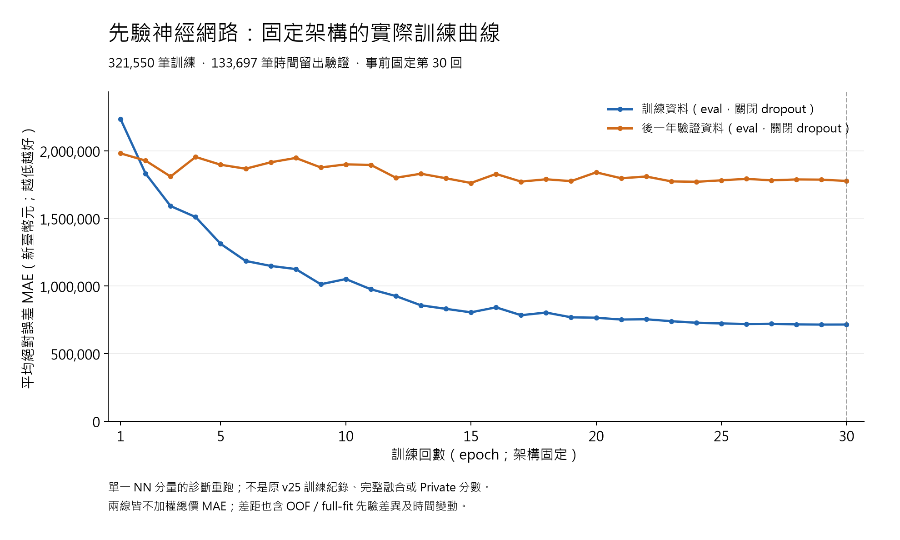

# v25 先驗神經網路：實際訓練曲線與講解

日期：2026-10-10。這份圖來自**另一次固定設定的診斷重跑**，以 v25 的先驗神經網路分量觀察訓練過程。它補足原 R107 未保存逐回驗證 MAE 的缺口；不是原 v25 那次訓練的逐回紀錄，也不是六模型完整中位數融合的曲線。

## 可以直接上台說的版本

「這張圖是我們自己實際訓練出來的結果。橫軸是訓練回數，從第一回到第三十回；模型大小一直相同。縱軸是平均預測誤差，單位是元，越低越好。藍線看模型對練習資料的表現，橘線看它對後面一年交易的表現。

練習資料的誤差由約 223.5 萬元，降到約 71.5 萬元；後面一年資料的誤差，則由約 198.1 萬元降到約 177.7 萬元，但中間有波動。這提醒我們：模型對練習資料越來越熟，不代表對未來資料也會等幅進步。

這次沒有出現教科書常畫的明顯 U 形，所以我們照實呈現，不能為了符合示意圖去改結果。兩條線有差距，也不能只用差距大小就證明過擬合或證明沒有過擬合，因為兩段資料的時間、房屋組成和先驗建立方式也有差異。我們在看驗證價格以前就固定訓練三十回，沒有看完圖再挑誤差最低的一回。這張圖只描述其中一個神經網路；最終提交還有其他模型與校正融合。」

## 兩條線怎麼產生

| 項目 | 本次實際設定 |
| --- | --- |
| 訓練交易 | 成交日期嚴格早於 2023-08-11；321,550 筆 |
| 時間留出驗證交易 | 2023-08-11 至 2024-08-10（含首尾）；133,697 筆 |
| 模型 | R107 prior NN 分量；原架構、seed 42、30 回、batch 2048、日期加權 SmoothL1，beta = 0.1 百萬元 |
| 橫軸 | 固定架構下的 epoch；沒有增加模型容量、層數或 dVC |
| 藍線／橘線共同量尺 | 每回快照均 `model.eval()`、關閉 dropout，換回總價後計算**不加權總價 MAE（新臺幣元）** |
| 真價精度 | 兩邊都用原 canonical raw 的 float64 元；fit 真價與原保存 fit_y 逐值一致，並核對 `train_y_million == float32(raw_fit_y / 1e6)` |
| 權重的角色 | 日期權重只用於原訓練損失。圖上兩條線都不加權，沒有把 SmoothL1 訓練損失與 MAE 混在同一張圖 |
| 標籤順序 | 先保存完整 30 個快照、封存身分並確認 train exit 0；之後才讀取本切分的驗證真價、離線評分 |
| 選回數方式 | 事前固定最後第 30 回；不 early stop、不選最低誤差 epoch、不掃參數 |

新增 trainer 與原 trainer 的科學流程相同，差異僅每回 `schedule.step()` 後保存一次 checkpoint。原九鍵 prepared、原訓練 metadata、四組 canonical/raw 列軸與日期來源皆以 SHA 綁定。真訓練不讀 query y；評分階段因原格式是 pickle，會一次 materialize 整張原價格表，再只取這個 confirmation 切分的 fit/query 列使用，不能把這稱為只載入驗證價格。完整流程見[事前計畫](v25_training_curve_plan_20261010.md)與[執行工具](../../research/src/v25_training_curve_20261010.py)。

## 真實觀察，以及不能推論的事

| 量測 | 第 1 回 | 固定第 30 回 | 第 30 回減第 1 回 |
| --- | ---: | ---: | ---: |
| 訓練 MAE（元） | 2,235,313.483439 | 715,006.131355 | -1,520,307.352083 |
| 時間留出驗證 MAE（元） | 1,981,140.434889 | 1,777,133.975919 | -204,006.458970 |

兩條線的末回差為 **1,062,127.844564 元**。訓練誤差整體下降得多，驗證誤差下降較少且有波動；第 21–30 回驗證 MAE 落在 1,770,810.76–1,809,790.25 元。本次沒有明顯「後段持續上升」的典型 U 形。這是當次觀察，不足以宣稱模型完全不會過擬合；第 30 回也不是經由本圖選出的最佳回數。

老師原本用欠擬合／過擬合圖解釋模型容量與誤差的關係。這裡呈現的是**容量固定、隨訓練回數變化**的實測，所以不能把橫軸改稱模型複雜度或 dVC，也不能將這張圖當作容量實驗。藍線可以白話叫練習誤差，橘線叫時間留出驗證誤差；它們不是理論上的精確 E_in／母體 E_out。

fit 的價格先驗採 group-fold OOF，query 的先驗由完整 outer-fit 建立；因此兩邊除了時間、交易分布不同，先驗生成方式也不同。曲線差距同時含這些因素，不能全部歸因於過擬合。此歷史驗證窗先前已反覆用於研究，不是全新盲測；本次只做單 seed 診斷重跑，不能當作多 seed 穩健性檢查，亦不保證在其他硬體逐 bit 重現。

**1,777,133.98 元是這次先驗 NN 單一分量的驗證 MAE。** 原 R107 同窗口 v25 完整融合約 1,381,702.87 元，是不同預測物的離線結果，不能混稱本圖末點。Kaggle Public 與未知 Private 也不是這張曲線的驗證資料。本次沒有新提交 CSV，原 v25 CSV、原選定、舊 release、原離線 gate 及歷史來源保持；新圖不構成改選模型或 epoch 的依據。[目前方法與版本界線](v25_method_and_code_20261010.md)。

## 執行與程式入口

主執行緒完成 freeze、train、evaluate；保存的 phase 牆鐘時間分別為 1.313、52.594、15.296 秒。train phase 含驗證輸入、單次 fit、30 快照檢查與封存；evaluate phase 含取得本切分標籤及逐快照評分，不能把整個 phase 說成純 GPU 訓練時間。

- [事前固定計畫](v25_training_curve_plan_20261010.md)：先定切分、原設定、30 快照與解讀限制。
- [獨立 trainer](../../research/src/round107_training_curve_train_20261010.py)：原科學碼加 6 行快照保存，未改原 trainer。
- [freeze／train／evaluate 工具](../../research/src/v25_training_curve_20261010.py)：三階段入口；標籤讀取受 30 快照 seal 和 train exit 0 限制。
- [本圖與白話報告 builder](../../research/src/summarize_v25_training_curve_20261010.py)：`--build` 只讀聚合 JSON 和身分／收據，不讀模型、原資料或逐筆標籤；`--check-vectors` 是另外一次只讀的 60 向量 MAE 核對，不做 fit。
- [曲線聚合 JSON](../outputs/v25_training_curve_20261010/curve.json)、[根 train 收據](../outputs/v25_training_curve_20261010/train_execution.json)、[根 evaluate 收據](../outputs/v25_training_curve_20261010/evaluate_execution.json)、[圖表建置收據](../outputs/v25_training_curve_20261010/report_build_execution.json)、[60 向量核對收據](../outputs/v25_training_curve_20261010/curve_vector_review.json)。

30 個模型快照、逐筆預測與標籤留在本機私有位置，不納 GitHub；可交付來源、聚合 30 點、此圖、說明及彙總身分收據。這不是從 raw 到乾淨環境的一鍵重訓驗證。

## 完整 30 點（同為不加權總價 MAE，元）

| 回數 | 訓練 MAE | 時間留出驗證 MAE | 驗證減訓練 |
| ---: | ---: | ---: | ---: |
| 1 | 2,235,313.483439 | 1,981,140.434889 | -254,173.048550 |
| 2 | 1,832,261.418880 | 1,927,632.081309 | +95,370.662429 |
| 3 | 1,591,415.616566 | 1,809,738.660140 | +218,323.043574 |
| 4 | 1,510,153.845019 | 1,954,629.432214 | +444,475.587195 |
| 5 | 1,311,856.898484 | 1,896,944.679681 | +585,087.781196 |
| 6 | 1,185,182.707770 | 1,867,611.845465 | +682,429.137695 |
| 7 | 1,148,706.166312 | 1,915,112.659924 | +766,406.493612 |
| 8 | 1,125,197.249660 | 1,947,167.406657 | +821,970.156997 |
| 9 | 1,012,946.973973 | 1,876,765.102078 | +863,818.128105 |
| 10 | 1,051,593.840388 | 1,899,582.895067 | +847,989.054679 |
| 11 | 975,804.995821 | 1,895,966.166377 | +920,161.170556 |
| 12 | 925,532.316399 | 1,800,641.355467 | +875,109.039068 |
| 13 | 857,222.787359 | 1,830,552.369747 | +973,329.582387 |
| 14 | 830,988.799595 | 1,796,817.871866 | +965,829.072271 |
| 15 | 805,182.482096 | 1,762,160.268498 | +956,977.786402 |
| 16 | 842,231.268894 | 1,828,975.623246 | +986,744.354352 |
| 17 | 784,054.076659 | 1,772,272.119995 | +988,218.043336 |
| 18 | 803,667.713205 | 1,789,328.484479 | +985,660.771274 |
| 19 | 768,591.063195 | 1,775,816.051417 | +1,007,224.988221 |
| 20 | 765,402.656387 | 1,840,723.687473 | +1,075,321.031085 |
| 21 | 751,954.601150 | 1,796,985.679352 | +1,045,031.078202 |
| 22 | 753,961.258588 | 1,809,790.246043 | +1,055,828.987455 |
| 23 | 739,706.724837 | 1,774,012.674985 | +1,034,305.950148 |
| 24 | 728,262.765758 | 1,770,810.760915 | +1,042,547.995158 |
| 25 | 723,131.753774 | 1,781,798.949445 | +1,058,667.195672 |
| 26 | 719,029.416399 | 1,792,743.549111 | +1,073,714.132711 |
| 27 | 720,744.088754 | 1,781,466.205574 | +1,060,722.116820 |
| 28 | 715,970.247165 | 1,788,213.306486 | +1,072,243.059321 |
| 29 | 714,630.710991 | 1,786,753.334111 | +1,072,122.623120 |
| 30 | 715,006.131355 | 1,777,133.975919 | +1,062,127.844564 |

## 聚合來源身分

曲線 JSON SHA256：`8c02ac44b579db70f918db180f1f54f3b3f603ef225c57ec900a74ac5fff0b6a`。來源依本機固定紀錄核對如下；列出 JSON 身分不代表私有逐筆資料將上傳。

- [reports/v25_training_curve_plan_20261010.md](v25_training_curve_plan_20261010.md)：`9fcafe852041782da3d274e91e2a9b6a34899824f5e477f5890a9ab3da5ac2be`
- [outputs/v25_training_curve_20261010/request.json](../outputs/v25_training_curve_20261010/request.json)：`7a99dd5fa4c5b79453089a5b7bfbd05fa8eedef405059003a0931247a9161599`
- [outputs/v25_training_curve_20261010/seal.json](../outputs/v25_training_curve_20261010/seal.json)：`62b4bfb48ee0bafd44c3148f79f100bc0e24e3da24089d691fe10c6e8b74180f`
- [outputs/v25_training_curve_20261010/model/training.json](../outputs/v25_training_curve_20261010/model/training.json)：`88e07eee4ef8588be8a07ee7d979bcf6cee626b0db8c6af0331c8b640c0d1cf1`
- [outputs/v25_training_curve_20261010/evaluation_labels.json](../outputs/v25_training_curve_20261010/evaluation_labels.json)：`13809ed78d538b1ceaaa464408add9fcdbdad544f7c4958f1799dba25cbf16b9`
- [outputs/v25_training_curve_20261010/private_prediction_manifest.json](../outputs/v25_training_curve_20261010/private_prediction_manifest.json)：`fef1c2faf2461e85a740ff76a48857dcef732f9919e28af726a91088ecb03d68`
