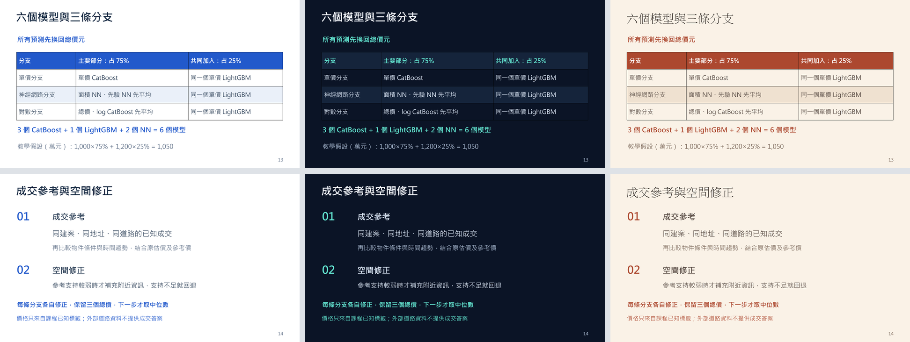

# v22 三種完整簡報風格・教學修訂版

[三款風格怎麼選](readability/三款風格怎麼選.md)附具體試播頁次；[字級與對比核查](readability/README.md)說明證據範圍。

另有[三款PDF投影備份與上台說明](projection/README.md)；使用相同r2投影片畫面。

三款都是同一個已選定的v22回歸模型，20頁主講＋3頁附錄。r2表示簡報教學修訂；使用者尚未選定視覺風格。

| 風格 | 完整 PowerPoint | 特徵 |
| --- | --- | --- |
| A 白底學術 | [下載](deliverables/臺灣房價預測_v22_白底學術_r2.pptx) | 白底、深藍與藍色重點 |
| B 深色科技 | [下載](deliverables/臺灣房價預測_v22_深色科技_r2.pptx) | 深藍底、青綠重點 |
| C 暖色雜誌 | [下載](deliverables/臺灣房價預測_v22_暖色雜誌_r2.pptx) | 米色、赭色與明體標題 |

配合[完整講稿](content/完整講稿.md)及[排練與16題問答](content/排練與問答.md)使用。主講4,789純漢字，250–300字／分估計15.96–19.16分鐘，配速規劃16:45；附錄與問答不計入，尚未真人計時排練。PowerPoint內23頁備忘稿已同步。

第13頁增加教學假設：1,000萬元×75%＋1,200萬元×25%=1,050萬元，是還原總價後、修正前的分支初估。第14頁說清楚三支各自修正後仍有三個總價，最後才取中位數；空間修正也使用原初估。範例不是真實test價格，也不證明75/25最佳。

Public MAE為使用者回報的1,998,568.5706元，Private未知。沒有新訓練或CSV，未代操作Kaggle。

## 報告與程式

- [原14頁零基礎報告](../v22_20261001/deliverables/臺灣房價預測_v22_零基礎報告.pdf)：模型方法仍適用，其4,658字／16:20屬原稿；本版使用上列新講稿。
- [推論入口](../../src/predict_v22.py)及[分支修正](../../src/tree_runtime.py)：對照六模型、三支修正及中位數。
- [方法導覽](../../evidence/reports/v22_method_and_code.md)、[R79三期結果](../../evidence/outputs/round79/results.json)、[Public回報](../../evidence/outputs/kaggle_feedback/public_submissions_v19_v24_20260927.json)。
- [複製清單](source_copy_manifest.json)、[製作時收據](delivery_receipt.json)、[內容修訂](content/content_revision_receipt.json)、[視覺核對](visual_review.json)。

原r1三款及完整渲染仍保存在C:/NYCU_ML原工作區。本目錄保存35份原件副本，其中包含六張改動頁PNG；其餘63張原渲染的SHA在製作收據中，未全部複製。原生表格、圖表及notes核驗已於原製作環境完成；本次Git發布只核對相同bytes，沒有重新製作。未桌面PowerPoint／投影實測。

## 製作來源的使用界線

build/A、B、C的build_deck.mjs與finalize_deck.mjs是最終來源，content/narrative.json為完整敘事。source_data.json只是保存摘要，builders實際仍讀原outputs下的R79結果及Public回報。

新增[重建入口與操作說明](../../docs/TEACHING_REBUILD.md)，可指定runtime路徑、只讀GitHub內資料，在新目錄生成三款。已用已發布的clone加既有Codex runtime實測，69張渲染與原版相同；未測試全新runtime安裝。原來源仍供追溯，不要直接在保存副本上執行以下歷史程式：

- prepare_sources.py、revise_narrative.py依賴原r1來源，且拒絕覆寫。
- run_all.py依賴本機Node，既有execution.json存在時拒絕重跑。
- package_revision.py還需原r1三款、舊渲染與九份保護原件。

製作需要Codex bundled Node／Python、@oai/artifact-tool及Presentations技能container_tools。原MJS保留作者路徑，新runner只在輸出副本中配置路徑。字型為Microsoft JhengHei、Consolas，C另需PMingLiU；歷史包裝程式需要Pillow。node_modules、runtime、技能工具和字型不隨Git散布。新入口已在現有環境實跑，尚未在全新套件環境重建。

講稿、JSON及PPTX notes中的sources以原工作區C:/NYCU_ML為基準。主要對照：原src/→本repo research/src/歷史程式或src/可攜推論；原reports/→evidence/reports/；原outputs/結果→evidence/outputs/。原件不一定全在Git中，不能把每個來源字串當成可點的repo連結。

delivery_receipt.json內GitHub_published_this_revision=false及本機路徑是製作當時記錄，保留原bytes。發布狀態以Git歷史為準，原工作區另存獨立發布收據。這不是完整重訓備份，模型／課程交易資料另保存在本機。

封面情境照片：Markus Winkler，Taipei，Unsplash，[來源](https://unsplash.com/photos/gray-concrete-building-vztbnMlTDNs)。不代表某筆課程交易。
